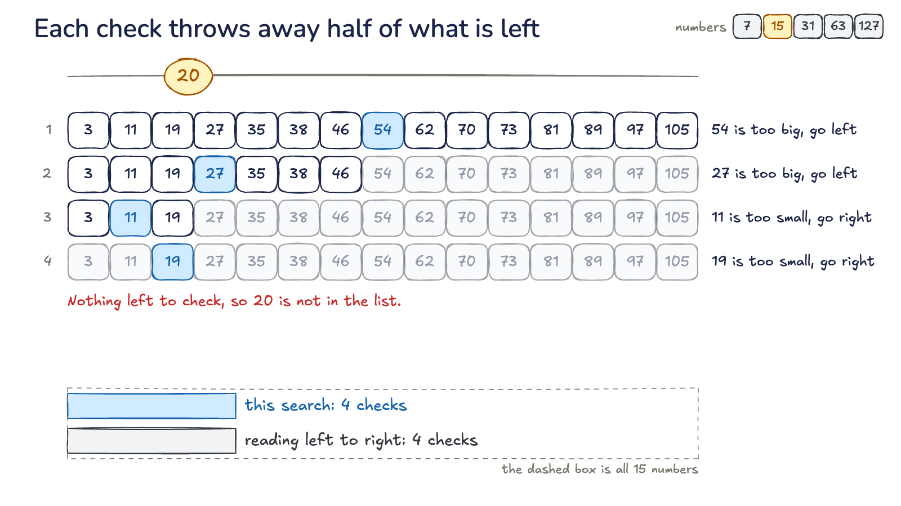

# handwave

Hand-drawn things you can poke. handwave runs Excalidraw scenes live in the
browser and moves them in response to input, where
[excalive](https://github.com/RafeSymonds/excalive) renders them to slides and
video.



## Run it

    npm install
    npm start

Then open http://localhost:4173. The front page shows a card per experiment and
grays out any that are not built yet.

The server listens on this machine only. To reach it from a phone, run
`HOST=0.0.0.0 npm start` on a network you trust.

## Experiments

| Experiment | Idea | Status |
|---|---|---|
| [Explorable](experiments/explorable) | Drag the target and every check of a binary search changes. Raise the count to see that doubling the numbers adds one check. | Working |
| Runnable diagrams | The drawing is the program. Rewire an arrow and it behaves differently. | In progress |
| Branching lesson | A voice asks a question, you click part of the drawing, and it answers what you chose. | In progress |
| Live deck | The presenter goes off script while the audience votes from their phones. | In progress |
| Whiteboard tutor | Ask a question and an agent draws and explains the answer. | In progress |
| Game: ink | Whatever you draw becomes a physical object. Get the ball to the flag. | In progress |
| Game: platformer | Every level is an `.excalidraw` file, so Excalidraw is the level editor. | In progress |

## How it works

An experiment is a function from state to a scene. `stage.show` compares the new
scene with what is on screen by element id: new elements enter, shared ones
change, and missing ones leave. Each animation starts from the element's current
look, so input can interrupt it at any time.

```js
import { createStage } from '/lib/stage.js';
import { box, color } from '/lib/draw.js';

const stage = await createStage(document.getElementById('stage'));
let on = false;

const view = () => box('switch', 600, 350, 400, 200, on ? 'on' : 'off', {
  tone: on ? color.green : color.gray,
});

stage.on('click', 'switch', () => {
  on = !on;
  stage.show(view());
});
stage.show(view());
```

Elements are native Excalidraw elements, drawn with rough.js options modelled on
Excalidraw's renderer. One DNS scene matches excalive's render by eye, but other
element types have not been compared. `loadScene` reads an `.excalidraw` file and
`toExcalidraw` writes one.

Each shape is compiled once to `Path2D`. Moving, rotating, fading or recoloring
reuses those strokes, and only a change of size or points generates new ones. In
Chrome on an M-series Mac, the frame interval stayed near 16.6 ms with 2,000
shapes moving (95th percentile 17.2 ms) and with 500 shapes resizing every frame
(95th percentile 19 ms). `node tests/bench.mjs` measures it on your machine.

## Layout

| Path | What |
|---|---|
| `lib/stage.js` | The runtime: scene changes, camera, input and the frame loop |
| `lib/render.js` | Draws Excalidraw elements on a canvas |
| `lib/draw.js` | Builds elements in code, with the house palette |
| `lib/page.html.txt` | The head every experiment page starts from |
| `experiments/<name>/` | One experiment. A `server.mjs` here adds a backend, described at the top of the root `server.mjs` |
| `tests/` | Browser tests, which drive Chrome through Playwright |

## Tests

    npm test

This needs Google Chrome installed. The tests use real mouse input and fail if the
page reports an error.

## Credits

Drawing is [rough.js](https://roughjs.com), freehand ink is
[perfect-freehand](https://github.com/steveruizok/perfect-freehand), and the look
and file format are [Excalidraw](https://excalidraw.com)'s. Excalifont, Virgil,
Cascadia Code and Nunito are under the SIL Open Font License, in
[`lib/fonts`](lib/fonts).
