# handwave

Hand-drawn things you can poke. handwave runs Excalidraw scenes live in the
browser and moves them in response to input, where
[excalive](https://github.com/RafeSymonds/excalive) renders them to slides and
video.

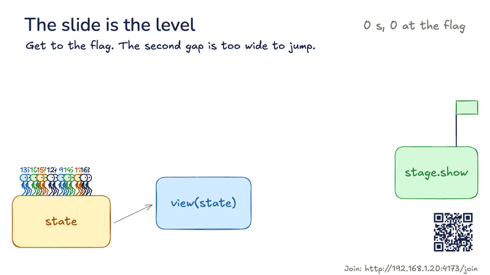

Every GIF here was recorded from the running page with scripted input. The phones in
the live deck's GIFs are simulated, and its address is a stand-in.

    npm install
    npm start

Then open http://localhost:4173, which has a card for each experiment.

## Live deck

A deck where the presenter can leave the script and the room takes part. Phones scan
a QR code on the title slide, then each slide can give them something to do. Dropped
phones reconnect and catch up on their own.

**The room votes**, and the bars grow as the votes arrive. Questions wait in a list
only the presenter sees.

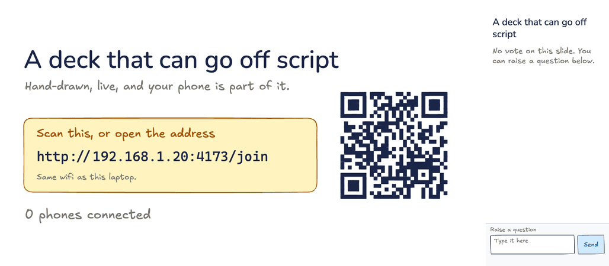

**The room is the system.** Every phone is a worker that taps to finish jobs. Ask them
to stop and the line backs up on the big screen, then takes longer to clear than it
took to build.

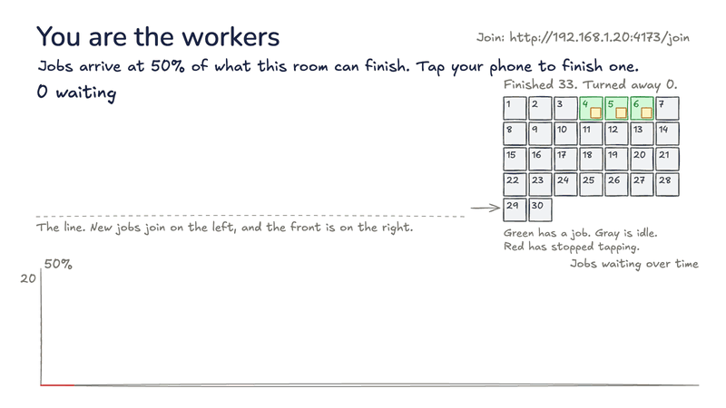

**The slide is the level.** The GIF at the top of this page: each phone steers a stick
figure, the slide's boxes are the ground, and your ink is new ground.

**The presenter goes off script.** Drag anything and draw on anything. Esc morphs it
all back to the script, and the audience sees every step.

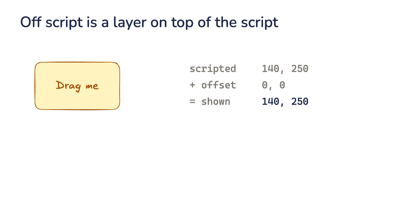

The room can also draw on a prompt, with only the drawings you approve reaching the
shared wall, and a vote can pick which slides come next. A finished talk can be
scrubbed through afterwards with its votes, ink and activities as they happened.

- Presenter: http://localhost:4173/experiments/live-deck/
- Big screen: add `?role=audience`. Phones use the code on the title slide.
- Phones need the server open to your network, with `HOST=0.0.0.0 npm start`. Only
  do that on a network you trust.

## Runnable diagrams

The drawing is the program. Shapes are parts, arrows join them, and labels say what
they do, so editing `workers 3` to `workers 1` makes the line back up.

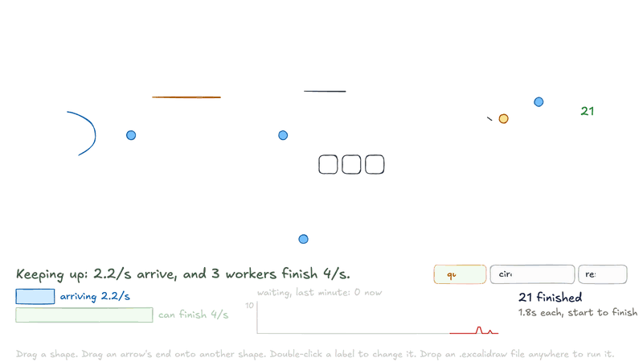

The page says what is allowed. Drag parts on from the palette and pull arrows between
them. Click any shape to see what the program thinks it is and which words it
understood. A misspelled word gets a message on the drawing, and clicking it fixes the
word. **What can I draw?** is a reference built from the table the parser reads.

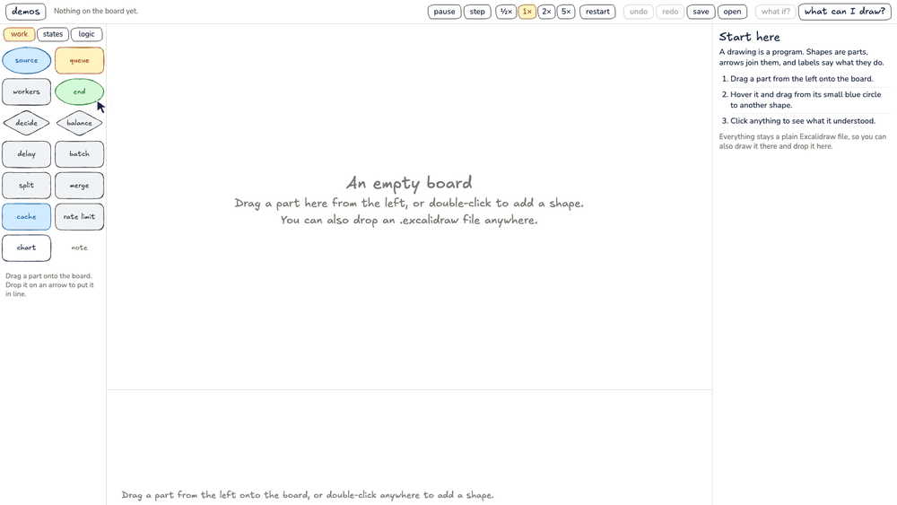

The same rules run flows of work, state machines, chance walks and logic circuits, and
the kind is worked out from the words you use. Here a clock and four flip-flops count
in binary:

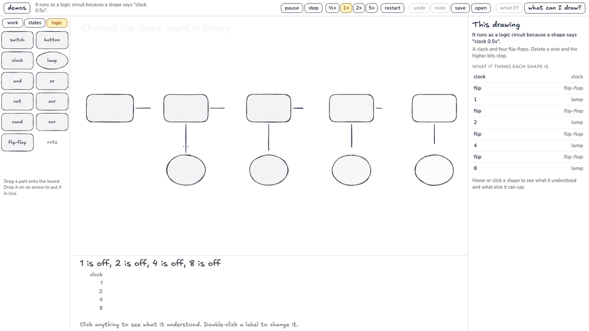

The page opens on 14 demos, and each one makes a claim you can test by changing the
drawing. **What if?** runs a drawing forward 40 times with different luck and draws
every run. Save writes a plain `.excalidraw` file, and you can drop one on the page to
run it. [`experiments/machine/README.md`](experiments/machine/README.md) lists every
word.

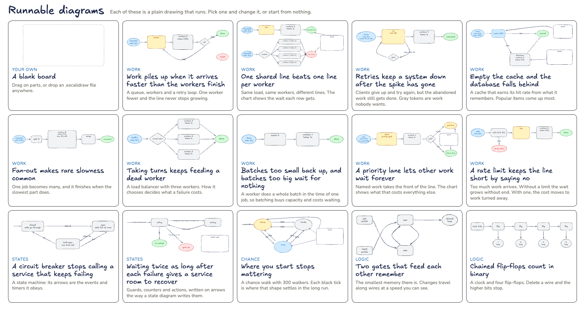

## Platformer

Every level is a plain `.excalidraw` file, so Excalidraw is the level editor. Gray
is ground, red is a hazard, blue is water or a spring, and a green diamond is the
goal. An arrow starting on a shape makes that shape move along it. Draw a level and
drop it on the page, or press E to edit in place and retry at once.
[`LEGEND.md`](experiments/game-platformer/LEGEND.md) has every rule.

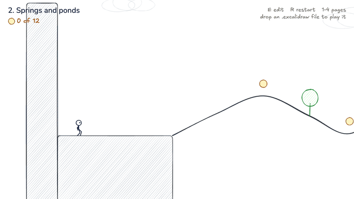

## Ink

Whatever you draw becomes solid. A stroke is a beam or a ramp, and a closed loop is
a heavy block. You have limited ink and eight levels to get the ball to the flag,
with more stars for using less.

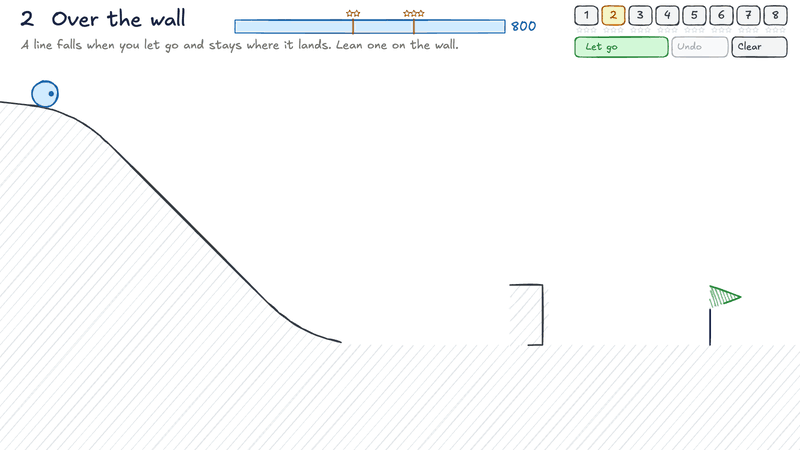

## Whiteboard tutor

Ask a question and an agent explains it while drawing the answer, with the drawing
growing as the model writes it. Click part of the board to point at it, then ask
about that part. This recording replays real model output with the voice off.

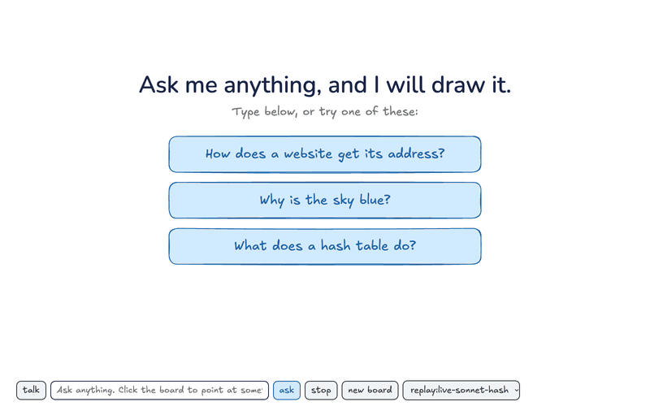

It runs the `claude` command you are logged in to, so each question uses your
subscription. It only answers requests from this machine and its own page.
Measured on an M3 Pro, the first words took 1.3 s and the first drawing 1.5 to
1.7 s with the prompt cached. A cold start took up to 8.2 s.

## Branching lesson

A narrated lesson that stops and asks, and you answer by clicking the drawing. Each
wrong answer gets its own voiced explanation and plays out on the picture before
the question returns. The source is one small
[`lesson.md`](experiments/lesson/lesson.md), voiced ahead of time by Kokoro on your
own machine. The lesson has sound, and this recording does not.

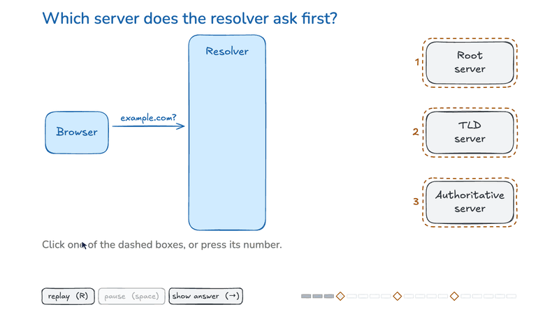

## Explorable

Drag the target and every check of a binary search changes at once. Raise the count
to see that doubling the numbers adds only one check.

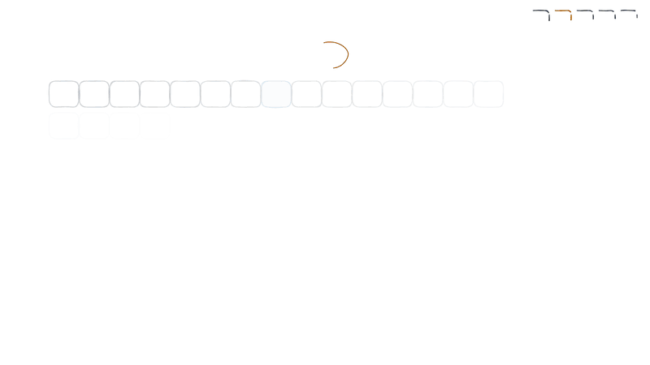

## How it works

An experiment is a function from state to a scene. `stage.show` compares the new
scene with what is on screen by element id: new elements enter, shared ones
change, and missing ones leave. Each animation starts from the element's current
look, so input can interrupt it at any time.

```js
import { createStage } from '/lib/stage.js';
import { box, color } from '/lib/draw.js';

const stage = await createStage(document.getElementById('stage'));
let on = false;

const view = () => box('switch', 600, 350, 400, 200, on ? 'on' : 'off', {
  tone: on ? color.green : color.gray,
});

stage.on('click', 'switch', () => {
  on = !on;
  stage.show(view());
});
stage.show(view());
```

Elements are native Excalidraw elements, drawn with rough.js options modelled on
Excalidraw's renderer. One DNS scene matches excalive's render by eye, but other
element types have not been compared. `loadScene` reads an `.excalidraw` file and
`toExcalidraw` writes one.

Each shape is compiled once to `Path2D`. Moving, rotating, fading or recoloring
reuses those strokes, and only a change of size or points generates new ones. In
Chrome on an M3 Pro, the frame interval stayed near 16.6 ms with 2,000 shapes moving
(95th percentile 17.2 ms) and with 500 shapes resizing every frame (95th percentile
19 ms). `node tests/bench.mjs` measures it on your machine.

## Not tried yet

These are experiments, and their tests can only prove so much:

- **Real people.** Nobody has played the games, so their feel and difficulty are
  unknown. The tests only prove every level can be beaten.
- **Real phones and rooms.** The live deck has only run on emulated and simulated
  phones on one machine, not on iOS Safari or a real room's wifi, and its activities
  were tuned on bots. The QR code is decoded from the slide's pixels in a test, not by
  a phone's camera.
- **Real sound.** Nobody has listened to the lesson, and the tutor's speech and
  microphone have not been tested with real audio.
- **Real Excalidraw files.** The runnable diagrams have run a file from Excalidraw's
  own converter, and the platformer's levels open in Excalidraw's renderer, but no
  file drawn by hand on excalidraw.com has been tried.

## Layout

| Path | What |
|---|---|
| `lib/stage.js` | The runtime: scene changes, camera, input and the frame loop |
| `lib/render.js` | Draws Excalidraw elements on a canvas |
| `lib/draw.js` | Builds elements in code, with the house palette |
| `lib/page.html.txt` | The head every experiment page starts from |
| `experiments/<name>/` | One experiment. A `server.mjs` here adds a backend, described at the top of the root `server.mjs` |
| `tests/` | Browser tests, which drive Chrome through Playwright |
| `tools/record-gifs.mjs` | Records the GIFs in `media/` by driving each experiment |

## Tests

    npm test

This takes several minutes and needs Google Chrome. The tests use real mouse,
touch and keyboard input and fail if a page reports an error. Screenshots go to
your temp folder, or to `SHOTS` if you set it.

## Credits

Drawing is [rough.js](https://roughjs.com), freehand ink is
[perfect-freehand](https://github.com/steveruizok/perfect-freehand), physics is
[matter.js](https://brm.io/matter-js/), QR codes are
[qrcode-generator](https://github.com/kazuhikoarase/qrcode-generator), and voices are
[Kokoro](https://github.com/hexgrad/kokoro). The look and file format are
[Excalidraw](https://excalidraw.com)'s. Excalifont, Virgil, Cascadia Code and Nunito
are under the SIL Open Font License, in [`lib/fonts`](lib/fonts).
